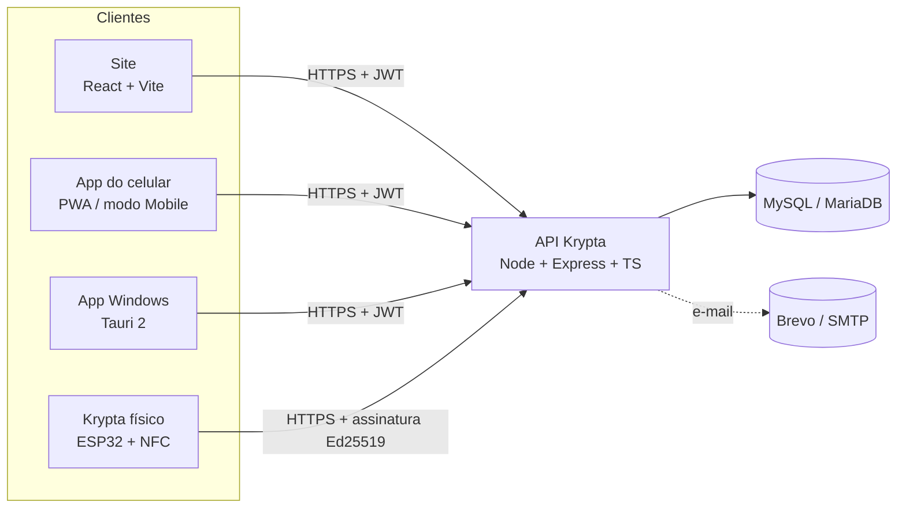

<div align="center">


# Krypta

**Cofre de senhas *zero-knowledge* com chave física, herança digital e acesso em qualquer aparelho.**

Site · App do celular (PWA) · App para Windows · API · Dispositivo ESP32


**No ar:** [krypta.website](https://krypta.website) · API `krypta-api.onrender.com`

</div>

---

## Sumário
1. [O que é o Krypta](#1-o-que-é-o-krypta)
2. [Funcionalidades](#2-funcionalidades)
3. [Planos](#3-planos)
4. [Arquitetura](#4-arquitetura)
5. [Segurança em uma página](#5-segurança-em-uma-página)
6. [Estrutura do repositório](#6-estrutura-do-repositório)
7. [Como rodar no seu computador](#7-como-rodar-no-seu-computador)
8. [Testes](#8-testes)
9. [As aplicações: site, celular e Windows](#9-as-aplicações-site-celular-e-windows)
10. [Hospedagem (no ar)](#10-hospedagem-no-ar)
11. [Documentação completa](#11-documentação-completa)
12. [Histórico de versões](#12-histórico-de-versões)
13. [Próximos passos](#13-próximos-passos)
14. [Autores](#14-autores)

---

## 1. O que é o Krypta
O Krypta guarda senhas, cartões, endereços, redes Wi-Fi e notas **cifrados no aparelho do usuário**.
O servidor recebe só um backup que **ele mesmo não consegue abrir**: nem o Krypta, nem quem invadir o servidor
consegue ler o conteúdo do cofre.

A chave do cofre mora num **dispositivo** (o navegador/app onde o cofre foi pareado ou um **Krypta físico ESP32**
com leitor NFC). Para emergências existem a **chave de contingência** (do dono), o **Kill Switch** (bloqueio
remoto), a **herança digital** (o **código de herança**, com a chave do herdeiro) e, desde a v1.2.0, a **senha de acesso** para abrir
e editar o cofre em qualquer aparelho e os **pontos de restauração**. Na v1.3.0 o cofre ganhou uma **trava no
próprio aparelho** (PIN, senha ou biometria) e o app ganhou o **Kody**, um assistente de ajuda.

> Nos textos do app, "CCP" passou a se chamar **chave de contingência** e "kit do herdeiro" virou **código de herança**.
> No código e na API os nomes técnicos (`ccp`, `cch`) continuam os mesmos.

## 2. Funcionalidades

| Área | O que faz |
|---|---|
| **Conta** | Cadastro, login, renovação automática de sessão, "onde minha conta está aberta", sair de tudo, trocar senha, excluir conta, recuperação de senha por e-mail |
| **Cofre** | Chaves com tipos (Login, Cartão, Endereço, Wi-Fi, Documento, Nota, Personalizado), campos secretos, ícones de marcas reconhecidos pelo nome, busca, gerador de senha forte |
| **Dispositivo** | Pareamento de dispositivo de software (navegador/app) ou do Krypta físico (ESP32 + NFC), login por assinatura Ed25519 (challenge-response) |
| **Chave de contingência** (CCP) | 160 bits, mostrada uma vez; recupera o cofre, troca de dispositivo, aciona o Kill Switch, abre a trava se esquecer o PIN |
| **Trava do cofre** (v1.3.0) | PIN de 6 dígitos ou senha (e biometria opcional) que tranca o cofre **até no aparelho pareado**; criada no pareamento; tranca sozinha em 5 min |
| **Kody** (v1.3.0, v1.4.0) | Assistente no site, no celular e no Windows: conversa de verdade (perguntas de volta, fluxos guiados, check-up, gerador de senha), com base no plano, no cofre, no aparelho e no questionário |
| **Notificações** (v1.3.0) | Avisos de segurança no Windows (notificação do sistema), no navegador e dentro do app; sino com não lidas |
| **Foto de perfil** (v1.4.0) | Anônimo por padrão; 12 avatares do Kody com a cor de fundo à escolha, ou foto própria |
| **Início** (v1.4.0) | Site e Windows com o mesmo Início do app: cofre, resumo, atividades, Kody e atalhos |
| **Kill Switch** (Pro) | Bane o dispositivo perdido para sempre e permite vincular outro com a CCP |
| **Herança digital** (Pro) | Código de herança (ID da conta + chave do herdeiro); o herdeiro resgata o cofre sem ter conta |
| **Senha de acesso** (Pro, v1.2.0) | PIN de 6 dígitos ou senha para **ver e editar** o cofre em qualquer aparelho logado |
| **Pontos de restauração** (v1.2.0) | "Salvar o estado do cofre" e voltar a ele; exige a CCP |
| **Relatórios** | Quem entrou, de onde (site, celular, app instalado, Windows), quem editou o cofre e quantas chaves mudaram |
| **Perdi minha CCP** | Nova CCP pelo dispositivo + senha, ou abandonar o cofre (senha + código por e-mail) e começar do zero |
| **Inatividade** | Avisos por e-mail (30 dias, 15 dias, 48 h) antes de excluir contas abandonadas há 365 dias |
| **Loja** | Assinatura do Pro e compra do dispositivo físico (pagamento simulado), "Minhas compras", rastreio e "Recebi" |
| **Modo Mobile** | Interface de app no celular/PWA, questionário de boas-vindas que recomenda o plano |
| **Aplicações** | Página que instala o app do celular (PWA) e baixa o app para Windows (.exe) na hora |

## 3. Planos

| | **Free** | **Pro** (R$ 25/mês ou R$ 225/ano) |
|---|:---:|:---:|
| Cofre cifrado + dispositivo de software | ✅ | ✅ |
| Espaço do backup cifrado | 64 KB | 1 MB |
| Tipos de chave | Login, Wi-Fi, Nota (até 3 campos) | Todos + campos extras ilimitados |
| Pontos de restauração | 2 | 20 |
| Senha de acesso em qualquer aparelho | — | ✅ |
| Ver com a CCP em outro aparelho | — | ✅ |
| Kill Switch | — | ✅ |
| Herança digital | — | ✅ |
| Alertas de acesso | — | ✅ |
| Dispositivo físico Krypta (R$ 599) | — | ✅ |

As regras ficam em `server/src/config/planos.ts`; o front só espelha (`src/utils/plan.ts`). **Quem bloqueia é o servidor.**

## 4. Arquitetura



- **Um front só** (`src/`) serve o site, o PWA e o app Windows. Mudou uma tela → muda nos três.
- **Uma API só** (`server/`) e **um banco só**: assinar o Pro no app aparece no site na hora.
- A criptografia do cofre roda **no cliente** (`src/crypto/kryptaCrypto.ts`); a API guarda bytes cifrados.

Detalhes: [docs/ARQUITETURA.md](docs/ARQUITETURA.md).

## 5. Segurança em uma página
- **Zero-knowledge:** o cofre é cifrado com AES-256-GCM no aparelho. O servidor guarda o `vault.enc` cifrado.
- **CCP/CCH nunca saem do aparelho:** o cliente deriva (Argon2id 64 MiB + HKDF) uma **prova**, que o servidor guarda
  como `bcrypt(HMAC-SHA256(pepper, prova))`, e uma **chave de envelope**, que nunca sai do cliente.
- **Dois tipos de token:** `admin_web` (site, 24 h, preso à sessão) e `hardware` (dispositivo, 15 min, preso à chave
  pública). Um Kill Switch derruba o token do dispositivo na hora.
- **Anti-rollback:** todo backup precisa de `version_counter` maior que o anterior.
- **Trava do cofre (v1.3.0):** os dados do dispositivo ficam cifrados no aparelho com uma chave aleatória,
  embrulhada pelo PIN (Argon2id), pela chave de contingência e, se ligada, pela biometria (WebAuthn PRF).
  Aberta só na memória; tranca em 5 min, ao recarregar e ao sair. Detalhes: [docs/TRAVA-AJUDA-AVISOS.md](docs/TRAVA-AJUDA-AVISOS.md).
- **Senha de acesso (v1.2.0):** a chave depende do PIN **e** de um segredo do servidor liberado só depois do PIN
  certo; 5 erros bloqueiam; criar e desbloquear exige a CCP.
- **Limites de tentativa** por IP, bloqueio de login, alertas por e-mail, cabeçalhos de segurança (helmet).
- Segredos só no `server/.env` (nunca no Git, nunca em variáveis `VITE_`).

Análise completa e limites honestos: [docs/ARQUITETURA.md](docs/ARQUITETURA.md) e [docs/COFRE-REMOTO.md](docs/COFRE-REMOTO.md).

## 6. Estrutura do repositório

```
Krypta/
├── src/                 Front-end (site + PWA + app Windows)          → src/README.md
├── public/              Ícones, manifest e service worker do PWA       → public/README.md
├── server/              API Node + Express + MySQL                     → server/README.md
│   ├── sql/             Banco: estrutura base + migrações 002 a 007    → server/sql/README.md
│   └── scripts/         Simulador de dispositivo e testes              → server/scripts/README.md
├── src-tauri/           App para Windows (Tauri 2)                     → src-tauri/README.md
├── hardware/            Firmware do Krypta físico (ESP32)              → hardware/README.md
├── scripts/             Utilitários do front (ícones, versão, .exe)    → scripts/README.md
├── docs/                Documentação técnica                            → docs/README.md
└── .github/workflows/   Gera o instalador .exe e publica no GitHub Releases
```

## 7. Como rodar no seu computador

**Precisa de:** Node.js 20+ (recomendado 22), XAMPP (MySQL/MariaDB) e Git ou GitHub Desktop.

```bash
# 1) Baixar
git clone https://github.com/viniciugonzaga/Krypta.git
cd Krypta

# 2) Banco: no phpMyAdmin crie o banco "krypta" e rode, NA ORDEM,
#    server/sql/001_base.sql → 002 → 003 → 004 → 005 → 006 → 007

# 3) Configurar
cp .env.example .env                 # front
cp server/.env.example server/.env   # API: preencha DB_*, JWT_SECRET e PASSWORD_PEPPER
cd server && npm run gerar-segredo   # rode 2x: um para JWT_SECRET, outro para PASSWORD_PEPPER

# 4) Instalar
cd .. && npm install && npm install --prefix server

# 5) Rodar front + API juntos
npm run dev
```

- Site: http://localhost:5173 · API: http://localhost:3333/api · saúde: http://localhost:3333/health
- Sem e-mail configurado (SMTP no PC ou `BREVO_API_KEY`), os códigos e alertas aparecem no **terminal da API**.

> ⚠️ Guarde uma cópia do `PASSWORD_PEPPER` fora do projeto. Se ele mudar, nenhuma CCP confere mais.

## 8. Testes
Com a API rodando, em outro terminal:
```bash
cd server
npm run sim -- testar-tudo     # cria uma conta nova e testa TODO o fluxo do cofre, planos, compras e v1.2.0
npm run sim -- limpar          # apaga a conta de teste
```
Lista de comandos: [server/scripts/README.md](server/scripts/README.md).

## 9. As aplicações: site, celular e Windows

| Aplicação | Como chega ao usuário | Atualização |
|---|---|---|
| **Site** | Navegador, `https://krypta.website` | **Sozinho**: cada push na `main` faz a Hostinger montar o site de novo |
| **App do celular (PWA)** | Aplicações → "Instalar no celular" (Android: botão; iPhone: Compartilhar → Tela de Início) | **Sozinho**, na próxima abertura |
| **App Windows** | Aplicações → "Baixar para Windows" (`Krypta-Setup.exe` do GitHub Releases) | Nova versão = GitHub Actions → **Run workflow** → instalar por cima |
| **Krypta físico** | Firmware `hardware/krypta-esp32` gravado pela IDE Arduino | Regravar o firmware |

Guias: [docs/MODO-MOBILE.md](docs/MODO-MOBILE.md) · [docs/DESKTOP.md](docs/DESKTOP.md) · [hardware/GUIA-CONEXAO.md](hardware/GUIA-CONEXAO.md)

## 10. Hospedagem (no ar)

| Parte | Endereço | Onde |
|---|---|---|
| Site + PWA | `https://krypta.website` | Hostinger Premium, montado direto do GitHub (Vite) |
| API | `https://krypta-api.onrender.com/api` | Render (Free, Node 22, pasta `server/`) |
| Banco | MySQL da Hostinger | Acesso remoto liberado só para o banco do Krypta |
| E-mails | `no-reply@krypta.website` | Brevo (API HTTP), opcional |
| App Windows | Aplicações → Baixar para Windows | GitHub Releases |

Um **push na `main`** atualiza o site (Hostinger) e a API (Render) sozinhos. Migrações SQL continuam manuais (phpMyAdmin).

- **Publicar uma versão nova (passo a passo): [docs/ATUALIZAR.md](docs/ATUALIZAR.md)**
- Como foi feito e como funciona hoje: **[docs/PRODUCAO.md](docs/PRODUCAO.md)**
- Passo a passo para refazer do zero: **[docs/HOSPEDAGEM.md](docs/HOSPEDAGEM.md)**

## 11. Documentação completa
Índice: **[docs/README.md](docs/README.md)**.

| Documento | Assunto |
|---|---|
| [docs/ARQUITETURA.md](docs/ARQUITETURA.md) | Componentes, criptografia, estados do cofre, modelo de ameaças |
| [docs/INTEGRACAO-API.md](docs/INTEGRACAO-API.md) | Todas as rotas da API e como o front usa |
| [docs/COFRE-ACESSO.md](docs/COFRE-ACESSO.md) | Ver com a chave de contingência, "Perdi minha chave", tipos de chave e ícones |
| [docs/COFRE-REMOTO.md](docs/COFRE-REMOTO.md) | Senha de acesso, relatórios e pontos de restauração |
| [docs/MODO-MOBILE.md](docs/MODO-MOBILE.md) | Modo Mobile, PWA e identificação do cliente |
| [docs/DESKTOP.md](docs/DESKTOP.md) | App Windows (Tauri) e publicação do .exe |
| [docs/PRODUCAO.md](docs/PRODUCAO.md) | Como o Krypta foi hospedado e como funciona no ar |
| [docs/HOSPEDAGEM.md](docs/HOSPEDAGEM.md) | Passo a passo para refazer a hospedagem |
| [docs/TRAVA-AJUDA-AVISOS.md](docs/TRAVA-AJUDA-AVISOS.md) | v1.3.0/1.4.0: trava do cofre (PIN/biometria), Kody, notificações, foto de perfil, Início e carregamento |
| [docs/ATUALIZAR.md](docs/ATUALIZAR.md) | **Como publicar uma versão nova** (site, API, banco, celular e Windows) |

## 12. Histórico de versões
| Versão | Principais mudanças |
|---|---|
| **1.4.0** | Kody (novo nome e muito mais esperto: perguntas de volta, fluxos guiados, check-up, gerador de senha); cartão "Fale com o Kody" no Início e no Perfil; Início do site igual ao do app; seção Novidades; avatares do Kody com cor de fundo; loader leve (WebP) e só quando precisa no celular |
| **1.3.0** | Trava do cofre no aparelho (PIN/senha + biometria) criada no pareamento; Kody, o robô de ajuda; notificações de verdade (Windows, navegador, app); foto de perfil/avatar padrão; cartões de dica; "chave de contingência" e "código de herança" nos textos; carregamento mais curto; fundo das telas de entrada nítido e animado; mais espaço entre os cartões |
| **1.2.1** | No ar: site em `krypta.website` (Hostinger) e API no Render; e-mails pela API HTTP da Brevo; imports com o nome exato das pastas (build no Linux); dependências atualizadas |
| **1.2.0** | Senha de acesso ao cofre (Pro), edição em qualquer aparelho com sincronia, relatório de edições, pontos de restauração com a CCP, campos extras só no Pro, editor completo no site, cofre abandonado não leva mais chaves para o novo |
| **1.1.0** | Ver o cofre com a CCP em outro aparelho, "Perdi minha CCP" (nova CCP / abandonar), tipos de chave, campos e ícones de marcas |
| **1.0.x** | Modo Mobile + PWA, app Windows (Tauri) e página Aplicações, firmware ESP32 fase 1, loja (planos e dispositivo), Kill Switch, herança, CCP, cofre zero-knowledge |

## 13. Próximos passos
- Firmware fase 2: cofre dentro do ESP32 e sincronia pelo próprio hardware.
- Gateway de pagamento real (hoje o pagamento é simulado).
- Login social (Google) em produção.
- App Android/iOS nativo empacotando o mesmo front (Capacitor), se a loja for necessária.

## 14. Autores
Projeto desenvolvido por Kevin Lima &bull; Lukas Bariani &bull; Sofia Moura &bull; Vinícius Gonzaga.
