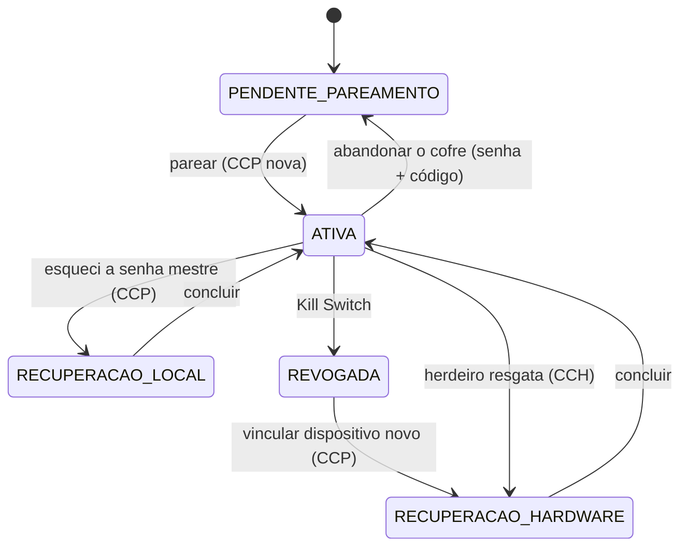

# Arquitetura do Krypta

## 1. Componentes

| Parte | Pasta | Tecnologia | Papel |
|---|---|---|---|
| Front | `src/` | React 19, Vite, TypeScript, Tailwind, framer-motion | Telas do site, do modo Mobile/PWA e do app Windows. **Faz toda a criptografia do cofre.** |
| PWA | `public/` | Manifest + service worker | Instala o front como app no celular; atualiza sozinho |
| App Windows | `src-tauri/` | Tauri 2 (Rust + WebView2) | Empacota o mesmo front num `.exe` |
| API | `server/` | Node, Express, TypeScript, mysql2, zod | Contas, sessões, planos, pedidos, regras do cofre, e-mails |
| Banco | `server/sql/` | MySQL / MariaDB | Usuários, sessões, auditoria, backup cifrado, provas, pedidos, dispositivos |
| Hardware | `hardware/` | ESP32 + PN532 (NFC) + tela GC9A01 | Guarda a chave privada Ed25519 e faz o login do cofre |

```
            Navegador / PWA / App Windows (mesmo código)
  ┌────────────────────────────────────────────────────────────┐
  │ telas (pages, mobile/pages)                               │
  │   └─ services/vaultFlows.ts   fluxos do cofre             │
  │        ├─ crypto/kryptaCrypto.ts  Argon2id·HKDF·AES-GCM   │
  │        ├─ services/virtualDevice.ts  "ESP32" de software  │
  │        └─ services/cofreRemoto.ts    senha de acesso      │
  │   └─ services/api.ts           HTTP + renovação de token  │
  └──────────────────────────┬─────────────────────────────────┘
                             │ HTTPS (JSON)
  ┌──────────────────────────▼─────────────────────────────────┐
  │ API  routes → middlewares (auth, escopo, cliente, limites) │
  │      → controllers (HTTP) → services/VaultRules (regras)   │
  │      → models (SQL) → MySQL                                 │
  │      jobs/ttlJob: inatividade (avisos e exclusão)           │
  └─────────────────────────────────────────────────────────────┘
```

## 2. Criptografia do cofre

### Segredos e o que vai ao servidor
| Segredo | Onde nasce | O que o servidor recebe |
|---|---|---|
| **Chave do cofre** (32 bytes) | Dispositivo | Nunca, só cifrada dentro dos envelopes |
| **CCP** (160 bits, Base32) | Cliente, mostrada 1 vez | `prova = HKDF(Argon2id(CCP))`, guardada como `bcrypt(HMAC(pepper, prova))` |
| **CCH** (herdeiro) | Cliente | Prova do herdeiro (mesmo esquema) |
| **PIN / senha de acesso** (v1.2.0) | Cliente | Prova do PIN + envelope do PIN |
| **Chave privada Ed25519** | Dispositivo/ESP32 | Só a chave pública |

### Derivação (parâmetros congelados)
```
master        = Argon2id(segredo, salt = SHA-256("krypta-ccp-v1:" + conta_id), m=64 MiB, t=3, p=1)
prova         = HKDF-SHA256(master, "krypta-prova-v1")         → servidor
chave_envelope= HKDF-SHA256(master, "krypta-envelope-ccp-v1")  → nunca sai
```
"info" diferentes = a prova que o servidor vê não abre o envelope.

### vault.enc (o backup)
```json
{
  "formato": "krypta-vault-demo-v1",
  "dados":            "AES-GCM(chave do cofre, JSON das credenciais)",
  "envelope_ccp":     "AES-GCM(chave da CCP, chave do cofre)",
  "envelope_herdeiro":"AES-GCM(chave da CCH, chave do cofre)  (opcional)"
}
```
O envelope do PIN (v1.2.0) fica numa tabela separada (`cofre_acesso_remoto`), não no backup.

## 3. Autenticação
| Token | Como se obtém | Dura | Preso a | Abre |
|---|---|---|---|---|
| `admin_web` | e-mail + senha (bcrypt, bloqueio após erros) | 24 h + refresh 7 dias | sessão (`jti` na tabela `sessions`) | conta, planos, pedidos, Kill Switch, herança, pontos |
| `hardware` | challenge → assinatura Ed25519 → verify | 15 min | chave pública vigente | backup do cofre, recuperação, troca de CCP |
| token do cofre (`X-Krypta-Cofre`) | PIN certo | 15 min | sessão do site + "geração" do PIN | ler e gravar o cofre em outro aparelho |

## 4. Estados do cofre

Regras de download/upload por estado: `server/src/config/estados.ts`.

## 5. Modelo de ameaças (resumo)
| Cenário | Resultado |
|---|---|
| Vazamento só do banco | Backups cifrados; provas com bcrypt + pepper (o pepper está no `.env`). Não dá para abrir cofres nem testar PINs offline. |
| Servidor inteiro comprometido | Ainda não abre o cofre pela CCP/CCH (160 bits). Um PIN de 6 dígitos pode ser quebrado com muito esforço → use "Senha (mais forte)". |
| Senha da conta vazada | Acessa a conta, mas não o cofre. Alertas e e-mails; "sair de tudo". |
| Dispositivo roubado | Kill Switch (Pro) bane a chave; CCP nova exige dispositivo **e** senha. |
| Rollback do backup | Recusado (`version_counter`). |
| Força bruta online | Limites por IP, bloqueio de login, 5 erros no PIN. |

Limitações conhecidas (projeto acadêmico): pagamento simulado, dispositivo de software guarda a chave no `localStorage`
do navegador (o ESP32 é o caminho seguro), limites de tentativa em memória (zeram ao reiniciar a API).
