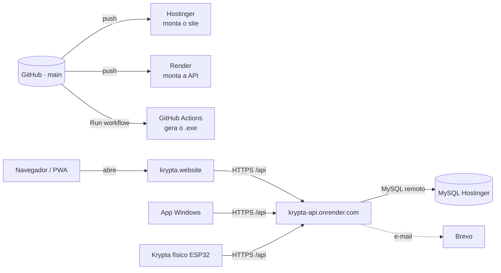

# Krypta em produção — como foi hospedado e como funciona hoje

> Registro da hospedagem feita em 22/11/2026 (versão 1.2.1).
> Para refazer do zero, siga o passo a passo em [HOSPEDAGEM.md](HOSPEDAGEM.md).

## Sumário
1. [Onde está cada parte](#1-onde-está-cada-parte)
2. [Como as partes conversam](#2-como-as-partes-conversam)
3. [Como foi feito (o processo)](#3-como-foi-feito-o-processo)
4. [Como ele está agindo agora](#4-como-ele-está-agindo-agora)
5. [Variáveis de cada serviço](#5-variáveis-de-cada-serviço)
6. [Operação do dia a dia](#6-operação-do-dia-a-dia)
7. [Limites e cuidados](#7-limites-e-cuidados)
8. [Problemas encontrados e como foram resolvidos](#8-problemas-encontrados-e-como-foram-resolvidos)

---

## 1. Onde está cada parte

| Parte | Endereço | Onde roda | Custo |
|---|---|---|---|
| **Site + PWA** | `https://krypta.website` | Hostinger, plano Premium (site próprio, montado a partir do GitHub) | Já incluso no plano |
| **API** | `https://krypta-api.onrender.com/api` | Render, Web Service Free (Node 22, pasta `server/`) | Grátis |
| **Banco MySQL** | servidor `srv….hstgr.io` · banco `u…_krypta` (dados reais só no painel) | Hostinger, mesmo plano, com MySQL remoto liberado para o Render | Já incluso |
| **E-mails** | remetente `no-reply@krypta.website` | Brevo (API HTTP) — opcional | Grátis até 300/dia |
| **App Windows** | botão **Aplicações → Baixar para Windows** | GitHub Releases (`Krypta-Setup.exe`) | Grátis |
| **Código** | `github.com/viniciugonzaga/Krypta` | GitHub, branch `main` | Grátis |

O domínio `krypta.website` é **separado** de qualquer outro site da conta Hostinger: o Krypta ocupa uma das vagas do plano
e não depende de nenhum outro domínio.

## 2. Como as partes conversam

- O **site** é só arquivo estático (HTML, JS, CSS). Ele não guarda nada: toda conta, plano e cofre passa pela **API**.
- Só a **API** entra no **banco**. Nenhum aparelho fala direto com o MySQL.
- O cofre continua *zero-knowledge*: a API e o banco guardam o backup **cifrado** e as provas, nunca as chaves.

## 3. Como foi feito (o processo)

| # | Etapa | O que foi feito | Por quê |
|---|---|---|---|
| 1 | Código no GitHub | v1.2.0 + documentação + ajustes de hospedagem (v1.2.1) enviados pelo GitHub Desktop, sem nenhum `.env` | Hostinger e Render montam tudo a partir do GitHub |
| 2 | Onde rodar a API | O Premium da Hostinger não roda Node.js (Node só nos planos Business e Cloud). A API foi para o **Render Free** | Manter custo zero sem trocar de plano |
| 3 | Domínio | Registrado `krypta.website` na Hostinger, verificado por e-mail | Não misturar o Krypta com outros sites da conta |
| 4 | Site | **Criar site → importar do GitHub**, predefinição **Vite**, Node 22, diretório raiz `./`, 3 variáveis `VITE_` | A Hostinger monta o `dist/` sozinha a cada push |
| 5 | Banco | Criado o banco `u…_krypta` no painel do `krypta.website`, rodados `001` a `007`, MySQL remoto liberado (qualquer host, só esse banco) | O Render não tem IP fixo |
| 6 | Segredos | `JWT_SECRET` e `PASSWORD_PEPPER` novos para produção, gerados com `npm run gerar-segredo`, senha do banco aleatória | Separar produção do PC e não reaproveitar senhas |
| 7 | API | Web Service no Render: root `server`, build `npm install --include=dev && npm run build`, start `npm start`, health `/health` | Log final: `✅ Conectado ao MySQL` e `Your service is live` |
| 8 | E-mails | Código passou a enviar pela **API HTTP da Brevo** quando há `BREVO_API_KEY` | O Render grátis bloqueia SMTP (portas 25, 465 e 587) |
| 9 | App Windows | Variáveis `VITE_API_URL` e `VITE_SITE_URL` no GitHub Actions → **Run workflow** | O `.exe` leva o endereço da API dentro dele |

## 4. Como ele está agindo agora

**Quando alguém usa o Krypta**
1. O navegador baixa o site de `krypta.website` (com HTTPS da Hostinger).
2. Toda ação (login, criar conta, salvar chave) vira uma chamada HTTPS para `krypta-api.onrender.com/api`.
3. A API confere token, plano e limites, grava no MySQL da Hostinger e responde.
4. O PWA instalado no celular é o mesmo site: atualiza sozinho quando o site muda.

**Quando o código muda**

| Você faz | Acontece sozinho |
|---|---|
| Push na `main` | A Hostinger remonta o site (aba **Implantações**) e o Render remonta a API (aba **Events**), em poucos minutos |
| Run workflow no GitHub Actions | Sai uma Release nova com `Krypta-Setup.exe`; o botão do site já baixa ela |
| Migração SQL nova | **Não** é automática: rodar no phpMyAdmin da Hostinger |

**A API "dorme"**: no plano grátis o Render desliga a API depois de 15 minutos sem uso. O primeiro acesso depois disso
leva até ~1 minuto. Um despertador no `cron-job.org` chamando `/health` a cada 10 minutos mantém ela acordada
(750 horas grátis por mês cobrem um serviço ligado o mês inteiro).

**Rotina de inatividade**: roda 30 s depois que a API sobe e a cada 6 h. Ela só exclui contas se os avisos por e-mail
saírem — sem a Brevo configurada, nenhuma conta é excluída.

## 5. Variáveis de cada serviço

Este repositório é **público**: nome do servidor, usuário do banco, senhas e segredos não aparecem aqui. Os **valores** ficam só nos painéis e num bloco de notas fora do projeto. Nunca no GitHub.

| Serviço | Variáveis | Observação |
|---|---|---|
| Hostinger (site) | `VITE_API_URL`, `VITE_SITE_URL`, `VITE_SOCIAL_LOGIN_ENABLED=false` | Vão para o navegador: nada secreto aqui. Mudou? **Reimplantar** |
| Render (API) | `NODE_VERSION=22`, `NODE_ENV=production`, `DB_HOST`, `DB_PORT`, `DB_USER`, `DB_PASSWORD`, `DB_NAME`, `JWT_SECRET`, `PASSWORD_PEPPER`, `CORS_ORIGIN=https://krypta.website`, `TRUST_PROXY=1`, `MAIL_FROM`, `SUPPORT_EMAIL`, `BREVO_API_KEY` (opcional) | Mudou? **Save, rebuild, and deploy**. Não criar `PORT` |
| GitHub Actions | `VITE_API_URL`, `VITE_SITE_URL` (aba *Variables*) | Usadas só ao gerar o `.exe` |

> ⚠️ O `PASSWORD_PEPPER` de produção precisa de cópia guardada fora do projeto. Se ele mudar, nenhuma CCP do site confere mais.

## 6. Operação do dia a dia

| Quero… | Onde |
|---|---|
| Ver erros da API | Render → serviço `krypta-api` → **Logs** |
| Ver se o site foi montado | Hostinger → `krypta.website` → **Implantações** |
| Mexer no banco | Hostinger → `krypta.website` → **Bancos de dados → phpMyAdmin** |
| Ler um código de e-mail sem a Brevo | Render → **Logs** (procure `código`) |
| Testar a API inteira | `server/`: `$env:SIM_API="https://krypta-api.onrender.com/api"; npm run sim -- testar-tudo` e depois `npm run sim -- limpar` |
| Lançar o `.exe` novo | Subir a versão no `package.json` → push → Actions → **Run workflow** |

## 7. Limites e cuidados

- **Render Free:** dorme após 15 min, ~1 min para acordar, 750 h/mês por conta, sem SMTP.
- **MySQL remoto aberto** para qualquer IP (necessário para o Render): a proteção é a senha forte do usuário do banco,
  que só enxerga o banco do Krypta. Num plano Business/VPS dá para fechar isso.
- **Limites de tentativa** ficam na memória da API e zeram quando ela dorme ou reinicia.
- **Pagamento** continua simulado.
- **Vulnerabilidades apontadas pela Hostinger** em `react-router` afetam só o "Framework mode" (renderização no servidor);
  o Krypta roda no navegador. Atualizar quando a versão 7.18.5 do `react-router-dom` estiver disponível.

## 8. Problemas encontrados e como foram resolvidos

| Problema | Causa | Solução |
|---|---|---|
| Build da Hostinger com `UNRESOLVED_IMPORT` nos logos | Pasta `src/assets/Logos` (L maiúsculo) importada como `logos`; o Linux diferencia maiúsculas, o Windows não | Imports corrigidos para o nome exato. Ao criar arquivos, usar sempre o mesmo nome no código |
| E-mails não sairiam do Render | Render Free bloqueia SMTP | Envio pela API HTTP da Brevo (`BREVO_API_KEY`) |
| 14 avisos de vulnerabilidade | Dependências com correções novas | `npm audit fix` na raiz e em `server/` (nunca `--force`) |
